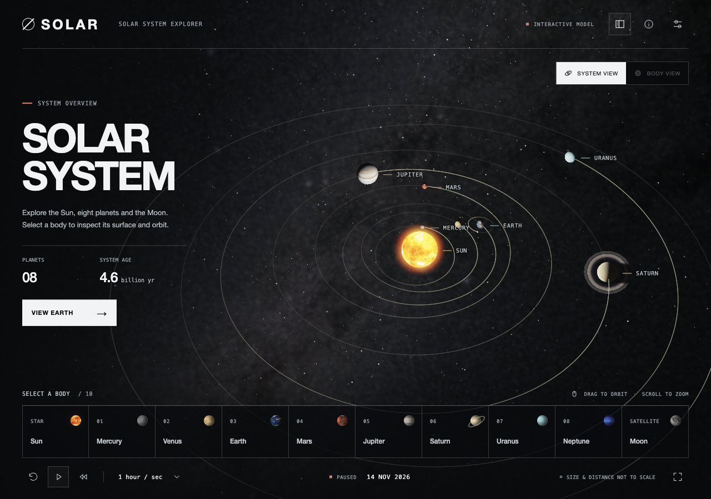

# Milky Way and starfield — 14 November 2026

The sky now uses the Gaia EDR3 equirectangular panorama for observed stellar
clouds and dust lanes, plus a deterministic point-star approximation. It stays
fixed in the app's J2000 world frame and uses the existing scene draw. Steady
frames remain **2–4 render draws**, with the existing **0 or 3 bloom dispatches**.
The implementation preserves the working tree captured at the start of this task,
including the prior rendering optimisations and Sun changes.

## Source and orientation

The [ESA/Gaia panorama](https://www.esa.int/media/interactive-map-of-the-sky-from-gaia-s-early-data-release-3)
provides the cloud/dust structure and colour. Credit is ESA/Gaia/DPAC,
acknowledgement A. Moitinho, under CC BY-SA 3.0 IGO. The downloaded 2000 × 1000 PNG
is stored unmodified; runtime resizing and brightness adjustment are disclosed in
About. See [the attribution record](TEXTURE-ATTRIBUTION.md) for the original URL,
licence and checksum. No runtime hotlink or image-generation dependency is used.

The world-to-Galactic transform composes the fixed ICRS-to-Galactic rotation from
[Gaia DR3 documentation, Eq. 4.62](https://gea.esac.esa.int/archive/documentation/GDR3/Data_processing/chap_cu3ast/sec_cu3ast_intro/ssec_cu3ast_intro_tansforms.html)
with J2000 obliquity 23.4392911° and the existing world convention:
`world = (ecliptic X, ecliptic Z, -ecliptic Y)`. The panorama's longitude zero is
at its centre; increasing longitude runs left. Camera position and simulation
clocks never rotate or translate this sky.

## Rendering and filtering

- Layer 12 of the existing sRGB array contains the panorama. Planet, Earth night
  and cloud indices stay intact. No bind groups, samplers, frame buffers or passes
  are added. The existing repeat-U/clamp-V sampler and scoped 2K/1K allocator
  serve the sky too, including OOM retry and bitmap cleanup.
- One explicit-LOD panorama sample is evaluated only for background rays, before
  the existing ring/atmosphere composition. Its footprint accounts for longitude
  stretching near the poles; it does not depend on implicit derivatives inside
  divergent ray-hit branches. A smooth 1.43° polar cap fade removes the coordinate
  singularity where the observed panorama is already dark.
- Panorama brightness is multiplied by 0.075 in linear light before the existing
  exposure, tone map and bloom. The constant background is slightly darker.
- Two bounded star layers use a cheap three-component hash, cell-centre jitter,
  mostly faint stars and a sparse bright tail, with restrained cool/warm colours.
  Cell-constant acceptance increases star counts near the Galactic plane without
  cutting points at cloud edges. The panorama modulates faint-star brightness.
- Gaussian widths include the pixel footprint, with reduced peak amplitude and
  a smooth fade for unresolved layers. Compact support reaches zero before grid
  faces, avoiding discontinuities when camera rays cross cell boundaries.

The Galactic map is observational, but its display intensity and point stars are
illustrative. This is not a calibrated naked-eye/photographic exposure model or a
catalogue of individual constellations. The sky is effectively at infinity;
proper motion, parallax and precession across simulation dates are omitted.
Planet/ring shading, local LOD, orbital geometry, exposure defaults and label
styles are unchanged. Planetary paths remain independent of the sky and moon LOD.

## Resource and rendering cost

The source PNG adds **3,885,439 bytes** to the download. The array grows from 12
to 13 layers: approximately **138.7 MiB at 2K** or **34.7 MiB at 1K**, including
mips, an increase of 10.7 or 2.7 MiB. The sky adds 11 or 10 startup-only mip draws
(143/130 total), and shares the existing two-bitmap decode limit. It creates no
per-frame JavaScript resources.

A compact procedural comparison used a latitude band, central bulge, warped dust
lane and two noise frequencies, bounded to the plane. It was less natural in
visual comparison; the actual panorama preserves the cloud structure without a
per-pixel noise stack. Neither candidate won every timing case, but their costs
were similar. The Gaia version was retained for visual quality and source fidelity.
The procedural candidate and its special shader hook were removed from production.

Measured in Chrome 157 on macOS, WebGPU vendor `apple`, architecture `metal-3`;
no specific GPU description is exposed. Baseline is this task's captured working
tree, not Git HEAD alone. Three variants ran in rotating order in the same isolated
page, with 1920 × 1080 targets, J2000, 2K maps, surface time 12 s, exposure 1.15,
bloom/atmospheres on and fixed cameras. Each view warmed up for 64 frames; results
are medians of seven 96-frame batches. The explorer loop was stopped.

| View | Original sky completion | Gaia sky completion | Added | Gaia GPU batch avg | Procedural completion |
| --- | ---: | ---: | ---: | ---: | ---: |
| Overview | 1.868 ms | 2.108 ms | 0.241 ms | 2.096 ms | 2.197 ms |
| Near-coplanar overview | 1.810 ms | 2.054 ms | 0.244 ms | 2.038 ms | 2.045 ms |
| Sun | 1.986 ms | 2.188 ms | 0.201 ms | 2.171 ms | 2.206 ms |
| Earth | 2.181 ms | 2.384 ms | 0.203 ms | 2.367 ms | 2.278 ms |
| Saturn | 3.023 ms | 3.220 ms | 0.197 ms | 3.190 ms | 3.320 ms |
| Galactic-centre sky only | 1.696 ms | 1.939 ms | 0.243 ms | 1.923 ms | 2.059 ms |

These are local observations: about **0.20–0.25 ms extra**, or 6–14% of these
frame-completion times. Desktop browser QA still observed 16.7 ms frame intervals.
CPU encode/submission remained about 0.03–0.04 ms in the batched measurements.
They are not predictions for other hardware. Raw batches and source hashes are in
[the results](MILKY-WAY-RESULTS.json).

### Timestamp correction

Exploratory per-frame timestamps overcounted the two-draw background fixture:
summed GPU ranges suggested about 24 ms/frame while the completed batch took
about 2 ms/frame. This backend can overlap render-pass/frame timestamp ranges
across submissions. Those sums were discarded. Both the retained benchmark and
the comparison now use **one timestamp pair for an entire batch**, from the first
scene start to the last composite end, divided by the frame count. No ranges are
summed; resolution/mapping remains outside the completion measurement. GPU elapsed
batch time can include scheduling gaps and is not an exact shader busy-time metric.
The prior rendering review's wall-clock completion results are unaffected.

## Verification

- `bun test tests/textures.test.js`: **8 passed**, including the 13-layer limit,
  2K/1K profiles, immediate/deferred OOM, cleanup and unrelated failures. Simulation,
  camera and HTTP unit groups were left out because their implementations did not
  change. `bun run textures` also confirms all fourteen downloads are cached.
- `/sky-verify.html`: **14 focused GPU checks**, including independent ICRS
  centre/pole directions, longitude handedness, seam/pole continuity, nonnegative
  finite radiance, plane/core contrast and direct CPU samples of the Gaia image.
  Maximum CPU/GPU sample error is **1.4e-5 HDR** at 2K and **1.3e-5** at 1K.
  Camera position/basis and clocks leave a fixed direction bit-identical; filtered
  low-resolution output stays bounded. An independent sky-branch replacement
  leaves fully occluded sphere pixels bit-identical. Sky draws/dispatches stay zero.
- The same fourteen checks pass with the advertised dimension limit masked to
  1024 to exercise the real 1K upload/mipmap path. This is a synthetic capability
  test on the same physical GPU, not a second hardware platform.
- `/verify.html`: **40 shared GPU checks**, covering texture/mip content, lighting,
  atmosphere references/composition, rings, eclipses, Sun appearance/animation,
  bloom, resource reuse, resize and validation.
- `/orbits-verify.html`: **14 focused orbit GPU checks**, including low/coplanar
  angles, near-plane crossings, every planetary close-up and local LOD independence.
- Benchmark checks cover an odd 641 × 359 target with bloom off and a 321 × 181
  run with timestamp support masked off. GPU timings are optional; CPU/completion
  reporting still works. No uncaptured GPU errors were observed.
- Visual QA covers overview, Sun/Earth/Saturn close-ups, navigation flights, labels,
  exposure 0.3/2, bloom on/off, 390 × 844 layout, information-panel visibility and
  source credits. The shared planet/moon typography remains intact.

For later sky-only changes, use the focused sky page. Broaden to shared rendering
checks when bindings, texture allocation or composition change, as in this task.
